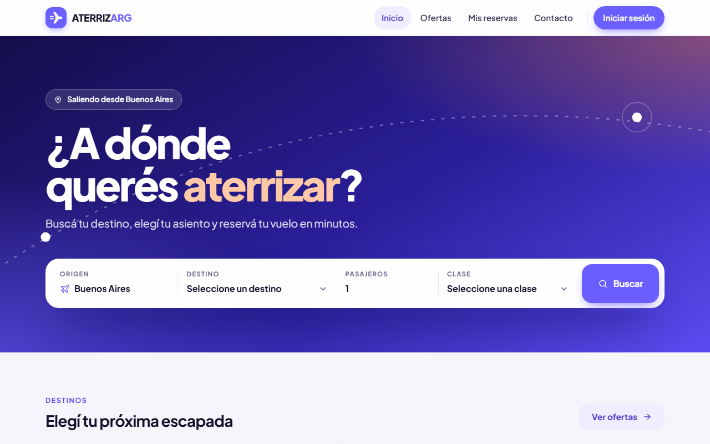
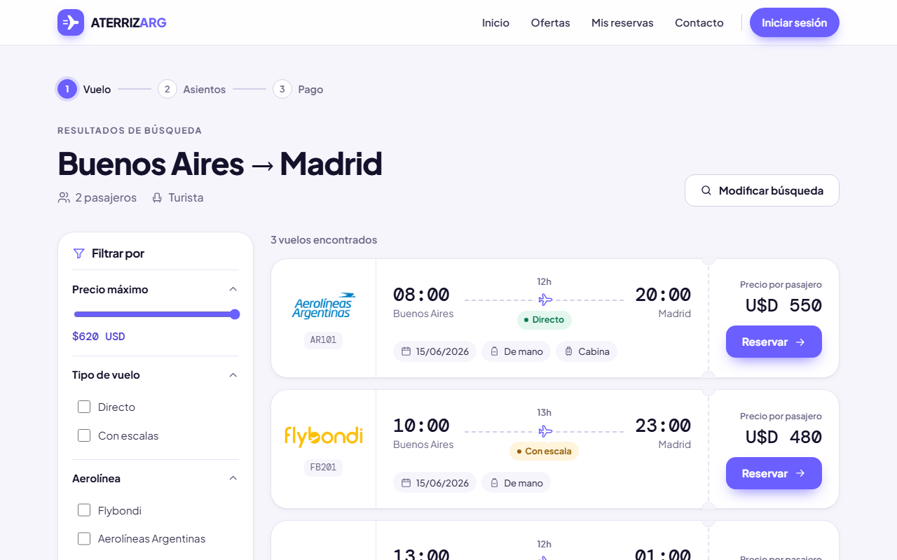
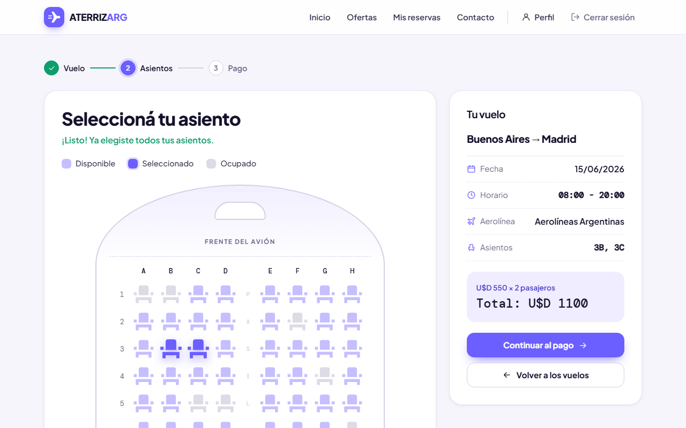
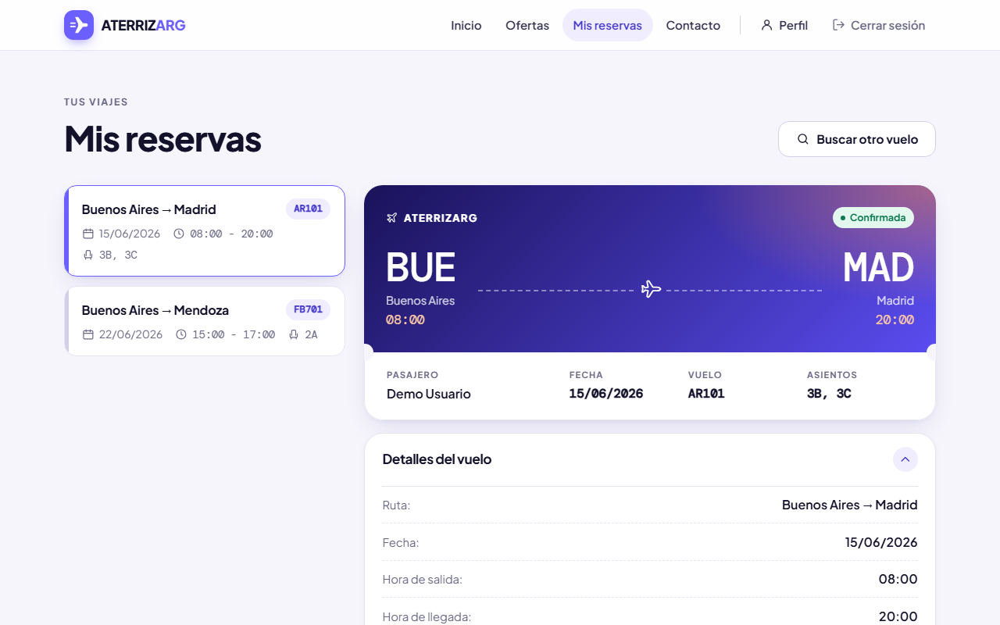

# ATERRIZARG ✈️

Aplicación web de reserva de vuelos: búsqueda de destinos, ofertas, calendario de vuelos, selección de asientos, checkout, gestión de reservas y perfil de usuario. Hecha con **HTML, CSS y JavaScript** puro, sin frameworks, con persistencia en `localStorage`.

**[Ver demo en vivo](https://isapias.github.io/Trabajo-Practico-PW1-ATERRIZARG/)**



| Resultados de búsqueda | Selección de asientos | Mis reservas |
| --- | --- | --- |
|  |  |  |

## Funcionalidades

- Buscador de vuelos por destino, cantidad de pasajeros y clase, con validación de datos.
- Resultados con filtros por precio, tipo de vuelo, aerolínea y equipaje.
- Ofertas y calendario con selección automática del vuelo.
- Mapa de asientos con resumen en vivo y cálculo del total a pagar.
- Checkout con tarjeta o transferencia, tarjetas guardadas y código de descuento.
- Registro, inicio de sesión, perfil, medios de pago y eliminación de cuenta.
- "Mis reservas" con pase de abordar y detalle en acordeón.
- Validaciones de formularios con expresiones regulares.

## Rediseño de la interfaz

Esta versión parte del trabajo práctico original del equipo y le suma un rediseño completo de la interfaz, manteniendo la lógica de la aplicación:

- **Sistema de diseño propio** en `styles/styles.css`: colores de marca, tipografía, botones, formularios y componentes compartidos por todas las pantallas.
- **Header y footer unificados**, con menú desplegable en celulares.
- **Diseño responsive** en las 13 pantallas, revisado en escritorio y en 390 px.
- **Notificaciones no bloqueantes** (`JS/ui.js`) en lugar de `alert()`, que se mantienen visibles después de una redirección.
- **Tarjetas de vuelo tipo "boarding pass"**, mapa de asientos dentro del fuselaje y vista previa de la tarjeta en el checkout.
- **Accesibilidad**: navegación por teclado en asientos y reservas, foco visible, etiquetas ARIA y soporte de `prefers-reduced-motion`.

También se corrigieron algunos errores del original: el enlace al checkout fallaba en servidores que distinguen mayúsculas, el menú no reflejaba la sesión en el checkout, y el vuelo más caro a Madrid quedaba oculto por el tope del filtro de precio.

## Mi aporte

Este proyecto nació como un **trabajo práctico grupal** de la materia Programación Web 1 (Tecnicatura en Desarrollo Web, UNLaM, 2026). En el trabajo original mi parte fue:

- **Checkout y confirmación de reserva**: maquetado y estilos de ambas pantallas.
- **Mis reservas**: diseño de la página y la vista en acordeón.
- **Accesibilidad de formularios**: asociación de `label` e `id` en todos los formularios del sitio.
- **Inicio**: footer, ajustes de grilla y lógica de validación de la búsqueda, guardándola en `localStorage`.

El rediseño de la interfaz de esta versión es posterior al trabajo grupal y no forma parte de la entrega original del equipo.

## Equipo del trabajo original

- Isaias Passeggi ([@Isapias](https://github.com/Isapias))
- Lucas Maidana
- [@juacucarrano](https://github.com/juacucarrano)
- Agustín Bejarano

Repositorio original del equipo: [juacucarrano/Trabajo-Practico-PW1-ATERRIZARG](https://github.com/juacucarrano/Trabajo-Practico-PW1-ATERRIZARG)

## Cómo correrlo

No necesita instalación ni dependencias. La forma más simple es usar la demo en vivo.

Para correrlo en tu máquina, serví la carpeta con cualquier servidor estático (por ejemplo, la extensión **Live Server** de VS Code) y abrí `index.html`. La sección de perfil carga sus partes con `fetch`, así que no funciona abriendo el archivo directamente con doble clic.

## Estructura

```
index.html          Inicio y buscador
pages/              Resto de las pantallas
styles/styles.css   Sistema de diseño base
styles/*.css        Estilos de cada pantalla
JS/ui.js            Notificaciones, menú móvil y helpers
JS/vuelos.js        Datos de los vuelos
JS/*.js             Lógica de cada pantalla
```
